  

  

    
    
    
    
  

## gm, I'm exothermic.

In crypto since **2017**. Now building **agent-native infrastructure for Solana** — MCP servers, transaction tooling, and local-first execution that keeps keys out of model context.

I like software that lets agents do real things without asking users to give up custody.

## Currently building

<table>
  <tr>
    <td width="50%" valign="top">
      
      <h3><a href="https://github.com/ex0th3rmic/pump-mcp">pump-mcp</a></h3>
      
Self-hosted Code Mode MCP server for pump.fun. Two tools — <code>search</code> and <code>execute</code> — for API discovery, direct Solana reads, and unsigned trades.

      
<code>Cloudflare Workers</code> <code>TypeScript</code> <code>MCP</code>

      
<a href="https://github.com/ex0th3rmic/pump-mcp"><b>Source</b></a> · <a href="https://pump-mcp.ex0therm.dev"><b>Live app</b></a>

    </td>
    <td width="50%" valign="top">
      
      <h3><a href="https://github.com/ex0th3rmic/pump-mcp-bundler">pump-mcp-bundler</a></h3>
      
Local-first operator console and MCP server for coordinated pump.fun trades, with encrypted Rust wallets, simulation-first execution, and atomic Jito bundles.

      
<code>Rust</code> <code>Svelte</code> <code>Jito</code>

      
<a href="https://github.com/ex0th3rmic/pump-mcp-bundler"><b>Source</b></a> · <a href="https://github.com/ex0th3rmic/pump-mcp-bundler#quickstart"><b>Run locally</b></a>

    </td>
  </tr>
</table>

## Toolbox

  
  
  
  
  
  

## GitHub activity

  <picture>
    <source media="(prefers-color-scheme: dark)" srcset="https://github-readme-stats.vercel.app/api?username=ex0th3rmic&amp;show_icons=true&amp;hide_border=true&amp;bg_color=00000000&amp;title_color=ece6e0&amp;text_color=9b928c&amp;icon_color=19c37d">
    
  </picture>
  <picture>
    <source media="(prefers-color-scheme: dark)" srcset="https://streak-stats.demolab.com?user=ex0th3rmic&amp;hide_border=true&amp;background=00000000&amp;stroke=23272f&amp;ring=ff6a3d&amp;fire=ff6a3d&amp;currStreakNum=ece6e0&amp;sideNums=ece6e0&amp;currStreakLabel=9b928c&amp;sideLabels=9b928c&amp;dates=9b928c">
    
  </picture>

---

  <b>ΔH &lt; 0</b> · releasing energy since 2017 · building in public  
  <a href="https://ex0therm.dev">website</a> · <a href="https://x.com/ex0therm">x</a> · <a href="mailto:hello@ex0therm.dev">email</a>  
  

